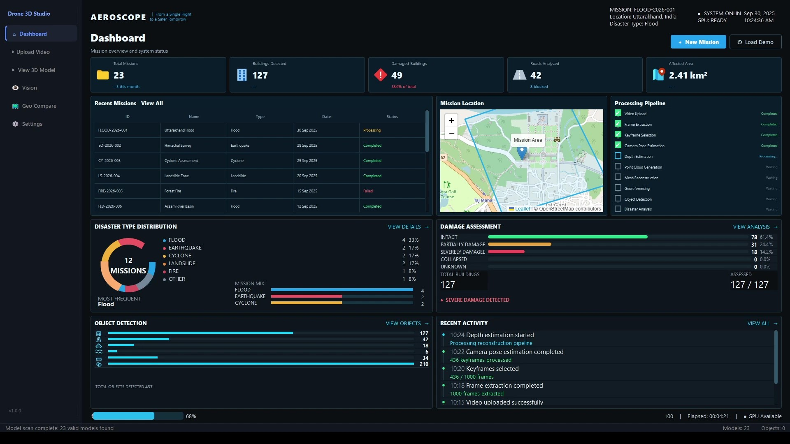
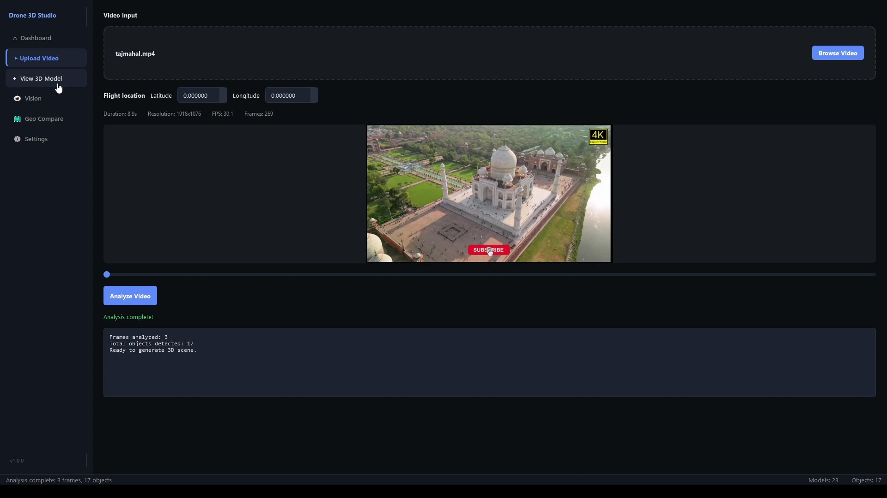
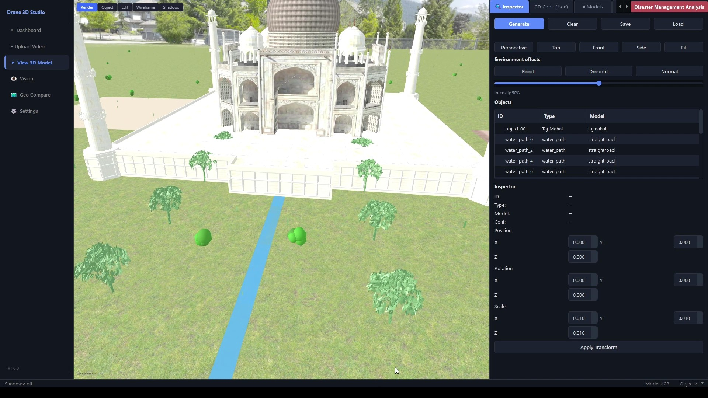
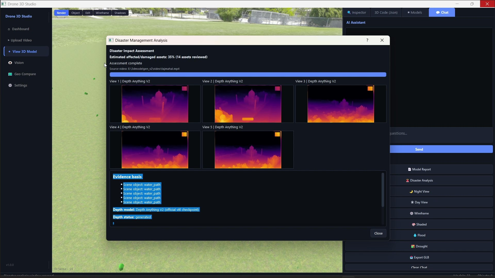
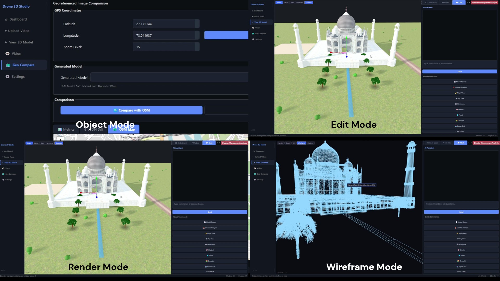
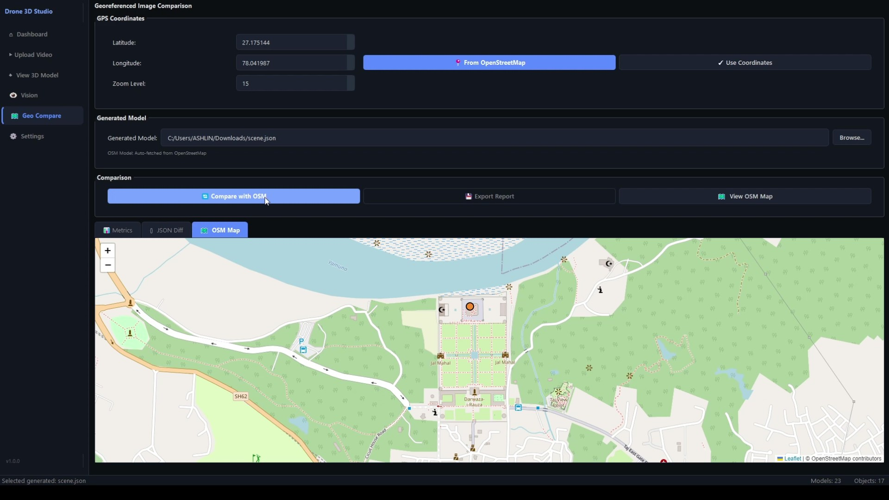
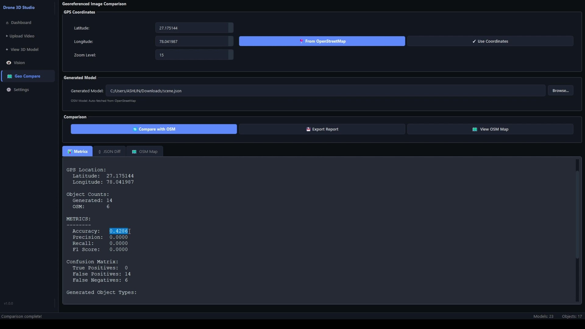

# AeroMap 3D

**AI-powered single-pass drone video to 3D mapping**

AeroMap 3D is a prototype workflow for turning UAV video and available GPS/flight metadata into a georeferenced 3D scene. It combines video frame analysis, visual reconstruction, AI depth estimation, geographic alignment, and an interactive viewer to support inspection and situational awareness.

> **Prototype note:** The screenshots show a working demonstration interface. Results depend on video coverage, camera motion, metadata quality, and the reconstruction pipeline. A single video pass cannot guarantee survey-grade accuracy or complete coverage; validate measurements and confidence before operational use.

## Product walkthrough

### 1. Mission dashboard

The dashboard summarizes missions, detected assets, affected area, processing status, and recent activity. The example view includes a mission map and a reconstruction pipeline status panel.



### 2. Upload and analyze a flight video

Choose a drone video, provide the flight location when available, inspect its duration and frame properties, and start analysis. The demonstrated workflow extracts representative frames and reports detected scene objects before model generation.



### 3. Inspect the reconstructed 3D scene

Explore the scene in the 3D viewer. The inspector lists scene objects and exposes camera presets, object transforms, and environment controls. Render, object, edit, wireframe, and shadow views help inspect the result from different perspectives.



### 4. Review depth and disaster-analysis evidence

The analysis panel presents depth-estimation previews for selected views and supporting scene evidence. These outputs can help an operator review the reconstruction; they should be treated as model estimates and checked against ground truth.



### 5. Compare scene rendering modes

The composite screenshot demonstrates object/edit and render views alongside a wireframe view. These visual modes help inspect scene structure and identify areas that may need closer review.



### 6. Compare with OpenStreetMap

Enter coordinates or use a map location to align the scene geographically, then compare the generated model with OpenStreetMap context. The interface also shows metrics, a JSON difference view, and a map view. OpenStreetMap is contextual reference data and does not independently validate model accuracy.



### 7. Review comparison metrics

The metrics panel summarizes object counts and comparison measures, with options to inspect a JSON difference or the map. Interpret metrics according to the selected reference data and evaluation method; example values in screenshots are illustrative of that run.



## Processing workflow

The intended reconstruction pipeline is:

1. **Frame extraction:** Sample frames from the UAV video, with adaptive sampling where supported.
2. **Quality assessment:** Score candidate frames for blur, exposure, and useful visual detail.
3. **Keyframe selection:** Choose diverse frames; GPS spacing and flight metadata can help where available.
4. **Structure from Motion:** Estimate camera poses and sparse geometry from overlapping visual features (the proposal names COLMAP).
5. **Depth estimation:** Predict per-frame depth (the proposal names Depth Anything V2).
6. **Geospatial alignment:** Use GPS/flight metadata and a coordinate reference system to orient and scale the reconstruction. Metadata quality limits alignment quality.
7. **Dense reconstruction:** Fuse depth and multi-view information into a colored 3D scene, with confidence information intended to distinguish stronger and weaker estimates.

The exact stages available depend on the implementation and input data. AI depth is an estimate; it does not by itself establish metric scale. Reliable scale and geographic accuracy require suitable calibration, metadata, and validation.

## Key capabilities shown

- Drone video upload and frame analysis
- 3D scene viewing and object inspection
- Render and wireframe visualization modes
- Depth-estimation previews and disaster-analysis interface
- Coordinate-based geographic context and OpenStreetMap comparison
- Comparison metrics, JSON differences, and report-oriented views
- Proposed exports and extensions such as GLB, semantic mapping, change detection, and GIS integration

## Potential applications

- Rapid disaster impact review
- Infrastructure and construction inspection
- Urban and environmental planning
- Terrain and asset visualization

These are intended use cases. Suitability depends on field validation, data quality, and the deployment's regulatory and safety requirements.

## Technology direction

The project description identifies Python, C++/COLMAP, CUDA, PyTorch, Depth Anything V2, computer vision, geospatial processing (WGS 84 / UTM), and 3D visualization tools such as PyQt5 and Open3D. Treat this as the proposed stack; consult the repository's implementation and dependency files for the components currently included.

## Demo

- **Video:** [AeroMap 3D demonstration](https://youtu.be/xNd1ujYksjE)
- **Idea:** AeroMap 3D — AI-Powered Single-Pass Drone Video to Accurate 3D Mapping
- **Idea ID:** 150015

## Getting started

This README documents the concept and interface shown in the supplied screenshots. Setup commands, supported operating systems, sample data, and dependency installation should be added once the corresponding implementation details are available in the repository.

## Repository images

Keep the screenshots in the repository at these paths so GitHub can render the walkthrough:

```text
images/
├── 1.jpg
├── 2.jpg
├── 3.jpg
├── 4.jpg
├── 5.jpg
├── 6.jpg
└── 7.jpg
```
